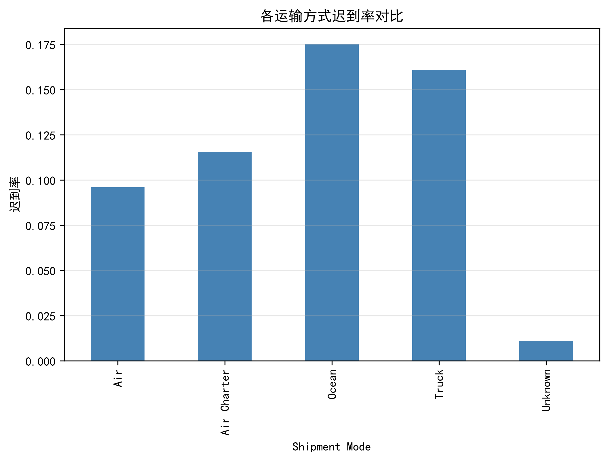
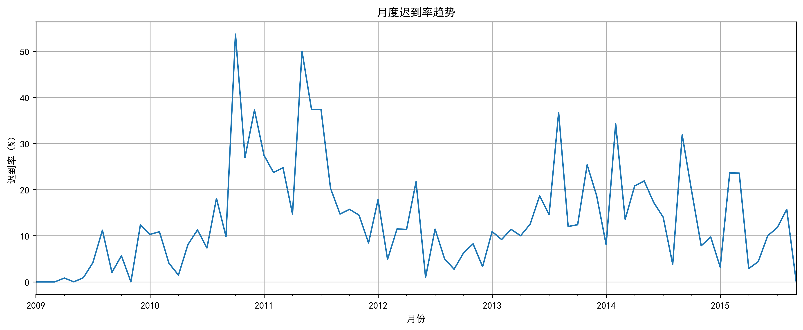
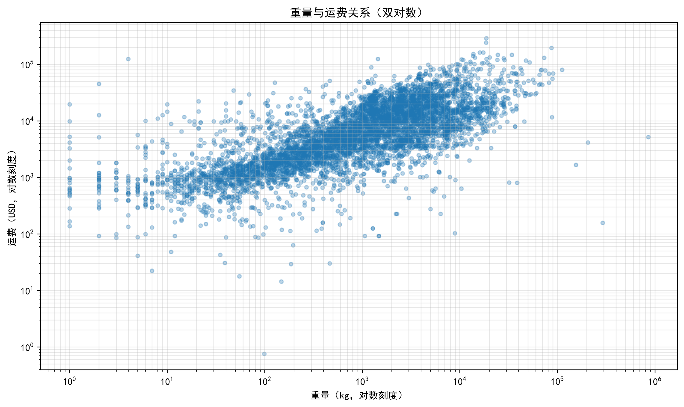

# 供应链运输时效与成本分析

用 pandas 分析供应链运输记录，回答三个问题：

1. 哪种运输方式的订单量、平均延误和迟到率更差？
2. 延误集中在哪些国家、供应商、月份？
3. 运费与重量是什么关系？是否存在异常订单？

## 背景与问题

医药供应链的运输时效和运费直接影响交付风险和成本。本项目基于 Kaggle 的 Supply Chain Shipment Pricing Data，分析不同运输方式的时效表现、延误集中环节，以及重量与运费的关系，为运输方式选择和异常订单核查提供依据。

## 数据来源

- 数据集：Kaggle Supply Chain Shipment Pricing Data
- 链接：https://www.kaggle.com/datasets/sawandikirby/supply-chain-shipment-pricing-data
- 原始数据未上传，下载方式见 `data/README.md`
- 记录数：10,324
- 时间范围：约 2006–2015 年
- 主要字段：`Shipment Mode`、`Country`、`Vendor`、`Scheduled Delivery Date`、`Delivered to Client Date`、`Weight (Kilograms)`、`Freight Cost (USD)`、`Line Item Insurance (USD)`

## 分析方法

- 数据清洗：修复文本编码、日期转换、数值转换、派生延误天数 / 是否迟到 / 送达月份；缺失值检查与说明；异常值检查与标注
- 分析：pandas 分组聚合、日期计算、相关系数（Pearson / Spearman / log-log）
- 可视化：matplotlib / pandas.plot
- 指标定义：
  - 延误天数 = 实际交付日期 - 计划交付日期
  - 迟到 = 延误天数 > 0
  - 单位重量运费 = 运费 / 重量

## 主要发现

1. **空运订单量最大，但海运和卡车的迟到率明显更高。** 空运 6,113 单，迟到率 9.6%；海运 371 单，迟到率 17.5%；卡车 2,830 单，迟到率 16.1%。海运和卡车接近，均约为空运的 1.7–1.8 倍。卡车的平均延误为 -9.9 天，但迟到率仍有 16.1%，说明它要么提前很多、要么迟到，时效分布比海运更分散。

2. **延误集中在少数供应商、国家和时段。** SCMS from RDC 占全部订单的 52%（5,404/10,324），贡献了 78% 的迟到订单（927/1,186），迟到率 17.2%，高于整体 11.5%。国家方面，Burundi（38.8%，98 单）、Congo, DRC（24.9%，333 单）、Mozambique（18.4%，631 单）的迟到率明显偏高；但 Burundi 样本不足 100 单，结论要谨慎。月份方面，2010-10（53.7%，54 单）、2011-05（50.0%，74 单）、2011-06（37.4%，107 单）迟到率偏高，但这些月份样本量不大，更适合看作阶段性波动，而不是稳定规律。

3. **重量与运费整体正相关，但关系非线性，且存在异常订单。** 在 6,174 条有效记录中，Pearson 只有 0.232，但 Spearman 为 0.742，取对数后 Pearson 为 0.729——说明重量越大运费越高，但不是线性增长；只看 Pearson 会低估关系。分运输方式看，空运的线性相关最弱（0.112），但 Spearman 高达 0.807；卡车和空运包机的线性相关更强（0.607、0.637）。按单位重量运费中位数，空运 10.02、空运包机 4.32、卡车 2.50、海运 1.68 USD/kg，空运约为海运的 6 倍。异常订单集中在两端：一端是 1–4 kg 却运费上万美元的极小额急件（最高 31,088 USD/kg），另一端是几十万公斤却运费极低的记录（最低 0.0005 USD/kg），后者更像重量或运费录入错误，建议核查。

## 图表







## 建议

1. **对海运和卡车增加计划缓冲期，优先复盘高风险组合。** 重点跟踪 SCMS from RDC、Burundi、Congo DRC、Mozambique 的迟到订单，分析是路线、清关还是排期问题。
2. **建立重量和运费的数据校验规则。** 对单位重量运费超过 P99、重量或运费为 0 或极端值的记录自动标记，避免异常值影响成本分析。

## 如何运行

```bash
pip install -r ../requirements.txt
jupyter notebook
```

打开 `supply_chain_analysis.ipynb`，按顺序运行。把 `Raw_Data.csv` 放到 `data/`，notebook 会自动读取。

## 目录结构

```
project-1-supply-chain/
├── supply_chain_analysis.ipynb
├── README.md
├── charts/
└── data/
    └── README.md
```

## 局限

- 国家和供应商分析只保留订单量 ≥50 的组，避免小样本导致的迟到率波动，但会漏掉小供应商的异常。
- 重量和运费同时有效的记录只有 6,174/10,324（59.8%）；卡车只有 41% 的记录两者齐全，分运输方式的成本结论对卡车要谨慎。
- 运费/重量中的备注文字（如 “Freight Included in Commodity Cost”）按缺失处理，未做插补。
- 异常值保留在相关性计算中，未删除；只在解释时单独讨论。
- 数据截至 2015 年，不能代表当前运营状况；相关不等于因果，迟到率还受路线、天气、清关等未观测因素影响。
